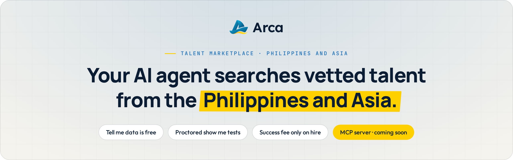
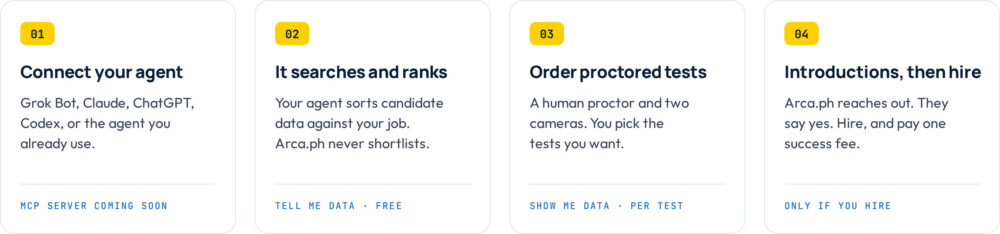
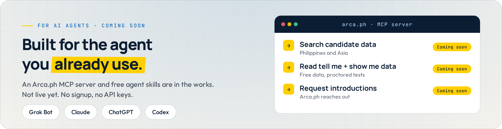

  <a href="https://arca.ph">
    <picture>
      <source media="(prefers-color-scheme: dark)" srcset="./assets/banner-dark.png">
      <source media="(prefers-color-scheme: light)" srcset="./assets/banner-light.png">
      
    </picture>
  </a>

  
  
  

<h3 align="center">Arca.ph is the dataset. Your AI agent does the sorting.</h3>

  Arca.ph is a talent marketplace for remote talent from the <b>Philippines and Asia</b>, built for the AI agents you already use: Grok Bot, Claude, ChatGPT, and Codex.
  Your agent searches the candidate data and ranks it against your job. Arca.ph never shortlists or ranks for you.

<b>Status:</b> coming soon. The marketplace, MCP server, and signup are not live yet.

 

## How it works

<picture>
  <source media="(prefers-color-scheme: dark)" srcset="./assets/how-it-works-dark.png">
  <source media="(prefers-color-scheme: light)" srcset="./assets/how-it-works-light.png">
  
</picture>

1. **Connect your agent.** Use the AI agent you already work with. The Arca.ph MCP server that makes this possible is coming soon.
2. **It searches and ranks.** Your agent reads the candidate data and sorts it against your job. Arca.ph sends the data. Your agent does the ranking.
3. **Order proctored tests.** When you want proof, order show me tests. Each one is run by a human proctor with two cameras.
4. **Introductions, then hire.** Ask Arca.ph to reach out to a candidate. If they say yes, that is an introduction. Hire them, and you pay one success fee.

## Tell me data and show me data

<table>
  <tr>
    <th align="left" width="50%">Tell me data · <code>free</code></th>
    <th align="left" width="50%">Show me data · <code>priced per test</code></th>
  </tr>
  <tr>
    <td valign="top">What candidates report about themselves. Free to view.  
      Resume · School · Work history · Expected monthly pay · Self-reported English · US-hours overlap · Screening answers · Personality test · AI video interview transcript
    </td>
    <td valign="top">Tests you order, run by a human proctor with two cameras: a screen share and the candidate's phone.  
      English exam · Cognitive test · Typing test · Coding test (no AI) · Hackathon (AI allowed) · Fire Drill (paired programming)
    </td>
  </tr>
</table>

## What it costs

| Item | What to expect |
|---|---|
| **Candidate data** | Free to view |
| **Proctored tests** | Priced per test. You order only the tests you want. |
| **Success fee** | 15% of first-year salary, paid once, only if you hire a candidate Arca.ph introduced, within 1 year of the introduction |
| **Replacement** | 3-month free replacement |
| **Talent pay** | Quoted per month |

No monthly markup on talent pay. The success fee is charged only if you hire.

## For AI agents

<a href="https://github.com/arca-ph/arca-mcp">
  <picture>
    <source media="(prefers-color-scheme: dark)" srcset="./assets/for-agents-dark.png">
    <source media="(prefers-color-scheme: light)" srcset="./assets/for-agents-light.png">
    
  </picture>
</a>

We are building an **Arca.ph MCP server** and free **agent skills** so your agent can search candidate data, read tell me and show me data, and request introductions.

> [!NOTE]
> **Coming soon.** Nothing here is live yet: no MCP server, no API, no signup. Watch [`arca-mcp`](https://github.com/arca-ph/arca-mcp) to hear when it ships.

## For talent

Candidates from the Philippines and Asia apply, get vetted, and get found by the AI agents clients use to search Arca.ph. Arca.ph contacts you about a job, and you decide whether to say yes.

 

  

  <a href="https://arca.ph"><b>arca.ph</b></a>
  &nbsp;·&nbsp;
  <a href="https://github.com/arca-ph/arca-mcp">arca-mcp</a>

Briarbear Labs Inc., doing business as Arca.ph

